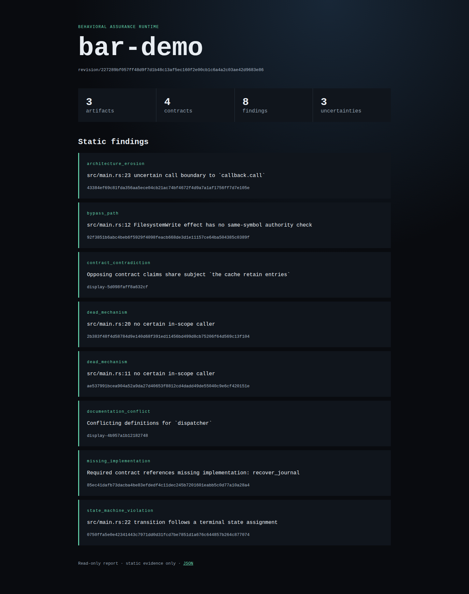
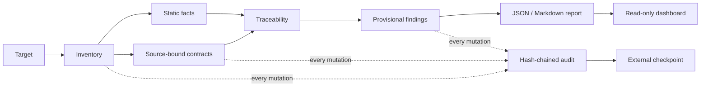

# BAR — Behavioral Assurance Runtime

[](https://github.com/primitive-0rigins/bar/actions/workflows/ci.yml)

An in-progress, model-optional software assurance system written in Rust. Its
implemented model-free core inventories a target, extracts source-bound
behavioral contracts, maps them to static evidence, and persists replay-safe
findings with explicit provenance. The planned long-running daemon builds on
that core with live evidence, **human-gated** repair handoff, and independent
post-change verification.

**Status at a glance**

- **Works today** — the model-free daemon bootstrap, a tamper-evident
  hash-chained audit log ([demo below](#see-it-catch-tampering)), a SQLite
  relational store, read-only target and revision identity,
  incremental artifact inventory, source-bound contract extraction with
  hierarchy and conflict adjudication, Rust/Python static architecture facts,
  deterministic contract-to-code traceability, proof obligations with
  revision-freshness policies, revision-bound shadow finding candidates, and
  replay-safe aggregated missing-implementation, contradiction,
  documentation-conflict, dead-mechanism, bypass-path, state-machine, and
  architecture-erosion findings. `bar scan` runs the complete static pipeline;
  `bar serve` presents its report in a read-only dashboard.
- **Awaiting human review** — completion evidence for Phases 5–7 under
  `docs/phase-evidence/`.
- **In progress** — the Phase 8 dashboard; report rendering is implemented,
  while adjudication and evidence drill-down remain.
- **Not yet built** — daemon watchers and target scheduling, runtime evidence
  capture, the human-approval workflow, coding-agent handoff, and post-change
  verification.

The build progresses phase by phase through [`docs/spec.md`](docs/spec.md)
§21; [`STATUS.md`](STATUS.md) records current work and completion evidence.

## Try the complete static pipeline

BAR now includes a deliberately flawed reference runtime. One command inventories
it, extracts its contracts, maps static evidence, persists an audited analysis,
and reports provisional findings:

```sh
cargo run -p bar-cli -- scan fixtures/bar-demo
```

The report demonstrates missing implementation, opposing contracts, conflicting
documentation, an unguarded effect path, dead code, a terminal-state reversal,
and an uncertain architecture boundary. See the checked-in
[`demo report`](docs/demo-report.md) for the expected shape.

Generate JSON and inspect it in the local read-only dashboard:

```sh
cargo run -p bar-cli -- scan fixtures/bar-demo --format json --output /tmp/bar-report.json
cargo run -p bar-cli -- serve /tmp/bar-report.json
```

The scanner never writes into its target. It uses an in-memory database unless
`--database` is supplied. For tail-deletion protection across durable scans, pass
an independently stored checkpoint with `--checkpoint /secure/path/bar.checkpoint`.



## What it is

BAR is a continuously maintained model of what a runtime *claims, permits,
executes, and can prove*. Its pipeline runs:

```
target pointer → artifact discovery → contract extraction → hierarchy & adjudication
→ static/path model → build-deployment identity → runtime evidence
→ proof-obligation & coverage → finding & causal investigation → repair-ready contract
→ human approval → coding-agent implementation → pre-merge impact → post-change verification
→ assurance history
```



### Ownership boundary

| BAR owns | Human owns | Coding agent owns | External systems own |
|---|---|---|---|
| Discovery, evidence, contracts, findings, repair constraints, verification | Interpretation rulings, approvals, waivers, accepted risk | Repository inspection, plan, edits, tests, implementation report | Source control, CI, artifact build, deployment, production credentials |

### Design commitments

- **Target-first resources.** The monitored workload owns the machine. BAR runs
  without a GPU, keeps no model resident by default, stays near-idle when nothing
  changes, and suspends optional semantic work under target pressure.
- **Concurrent multi-runtime monitoring (planned).** One daemon will watch
  multiple registered targets concurrently with isolated state, per-target job
  serialization, and bounded target-fair shared workers. Fleet-level pattern
  suggestions remain a later, separate capability.
- **Model-optional.** BAR remains useful with all models disabled.
- **Human-gated repair.** No repair job is visible to the coding agent before
  approval; approval binds to exact job content, target, scope, base revision,
  and expiry. BAR never grants production deployment authority.
- **Honest evidence.** Documentation is evidence, but may be stale, contradictory,
  or wrong — it never becomes proof on its own. Every finding cites exact evidence
  and states its limitations.

### Explicit non-goals

Not a personal companion, agent orchestrator, scheduler, security scanner, CI/CD
system, issue tracker, or observability replacement — and it emits no single
"correctness score." See [`docs/spec.md`](docs/spec.md) §2.1.

## Repository layout

```
bar/
├── crates/
│   ├── bar-core/      # IDs, enums, schemas, typed errors
│   ├── bar-config/    # configuration contract (spec Appendix C)
│   ├── bar-audit/     # append-only hash-chained audit log
│   ├── bar-store/     # sqlx store + migrations (SQLite; PostgreSQL planned)
│   ├── bar-target/    # read-only target resolution and revision identity
│   ├── bar-discovery/ # incremental inventory and dependency-aware reparse plans
│   ├── bar-contract/  # source-bound claims, hierarchy, glossary, conflicts
│   ├── bar-static/    # shadow static architecture facts (Phase 5 foundation)
│   ├── bar-coverage/  # deterministic contract-to-static-fact traceability
│   ├── bar-findings/  # shadow finding detection and stable aggregation
│   ├── bar-bench/     # resource benchmark harness (spec §4, §22)
│   ├── bar-daemon/    # the mandatory model-free process (spec §5.1)
│   └── bar-cli/       # end-to-end scanner, reports, and read-only dashboard
├── migrations/        # root SQL migrations, embedded at compile time
├── fixtures/          # versioned adversarial and end-to-end test corpora
├── docs/              # normative specification and phase evidence
├── STATUS.md          # living project status
└── Cargo.toml         # workspace root
```

The full target layout (19 crates, UI, adapters, fixtures) is defined in
[`docs/spec.md`](docs/spec.md) §5. Crates land as their phase is implemented, so
the tree always builds clean.

## Build

### Scanner quick start

```sh
cargo run -p bar-cli -- scan .
```

### Daemon bootstrap

BAR currently provides its model-free bootstrap daemon while the remaining
phases are under construction. From a checkout with Rust 1.94 or newer:

```sh
cargo run -p bar-daemon
```

The command initializes structured logging, reports its model-free readiness,
and exits cleanly. It does not yet watch a target or expose the planned API;
those capabilities land in later phases. Set `BAR_LOG_FORMAT=json` for
machine-readable logs. The daemon uses built-in defaults when no configuration
file is present; set `BAR_CONFIG=/path/to/bar.toml` to load an explicit,
validated configuration. Its complete contract is in
[`docs/spec.md`](docs/spec.md#appendix-c-complete-configuration-contract).

### See it catch tampering

The audit chain is BAR's current trust anchor, and its integrity checks can be
exercised in thirty seconds:

```sh
cargo run -p bar-audit --example tamper_evidence
```

The example seals a ruling, an approval, and an evidence mutation into the
chain, verifies the intact chain, then tampers with the "stored" records three
ways — rewriting an approval, deleting a ruling, and reordering events — and
shows verification refuse each one with the exact reason:

```text
sealed #0 ruling            ruled ambiguous retry contract as intended-once
sealed #1 approval          approved repair job within reviewed scope
sealed #2 evidence_mutation invalidated stale coverage evidence after repair

intact: chain verifies
edited record: REFUSED — corrupt input: audit record 1 content does not match its hash
deleted record: REFUSED — corrupt input: audit record at position 0 has seq 1
reordered records: REFUSED — corrupt input: audit record at position 1 has seq 2
```

Internal verification detects edits, insertion, reordering, and removal that
breaks the remaining sequence. Detecting deletion from the end requires an
externally retained length and tip; `verify_against_checkpoint` provides that
check, while durable checkpoint storage is not yet built.

### See deterministic configuration traceability

```sh
cargo run -p bar-coverage --example config_traceability
```

The example maps an explicit contract reference to the exact JSON configuration
path and source line, without treating the mapping as behavioral proof:

```text
mapping status: Mapped
`server.port` → config/runtime.json:1 (Configuration)
```

### See incomplete proof stay unproven

```sh
cargo run -p bar-coverage --example proof_assessment
```

The example maps `authorize` but deliberately leaves `audit` absent. Its
assessment remains unproven and names the gap instead of treating one matching
symbol as support for the whole contract:

```text
mapping status: PartiallyMapped
proof status: Unproven
unresolved: audit
```

### Verify a checkout

```sh
cargo test --workspace --all-targets
cargo clippy --workspace --all-targets -- -D warnings
cargo fmt --all -- --check
RUSTDOCFLAGS='-D warnings' cargo doc --workspace --no-deps
cargo audit --deny warnings
```

CI runs the same format, lint, and test gates on every pull request. See
[`CONTRIBUTING.md`](CONTRIBUTING.md) for contribution expectations and
[`SECURITY.md`](SECURITY.md) to report a vulnerability privately.

## Documentation

- [`docs/spec.md`](docs/spec.md) — the complete, normative implementation
  specification and build manual (the contract this repo is built against).
- [`STATUS.md`](STATUS.md) — current phase, delivered evidence, and known debt.
- [`CONTRIBUTING.md`](CONTRIBUTING.md) — development and review expectations.
- [`CODE_OF_CONDUCT.md`](CODE_OF_CONDUCT.md) — community participation standards.
- [`SECURITY.md`](SECURITY.md) — vulnerability reporting policy.

## License

Licensed under the [MIT License](LICENSE).
